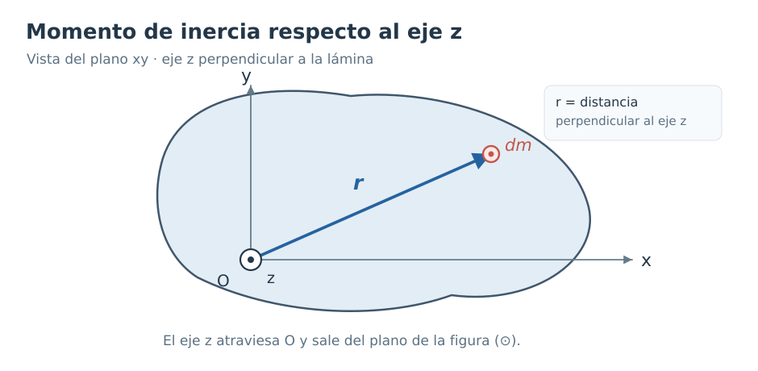
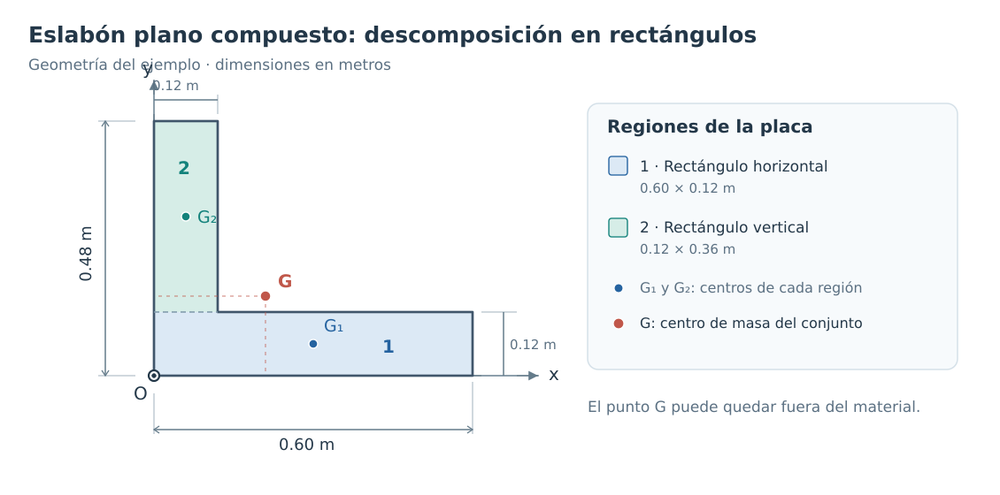
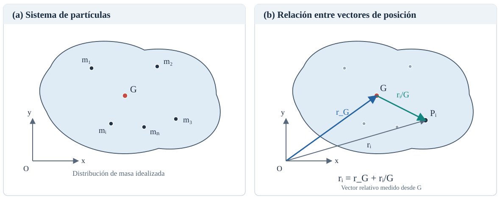
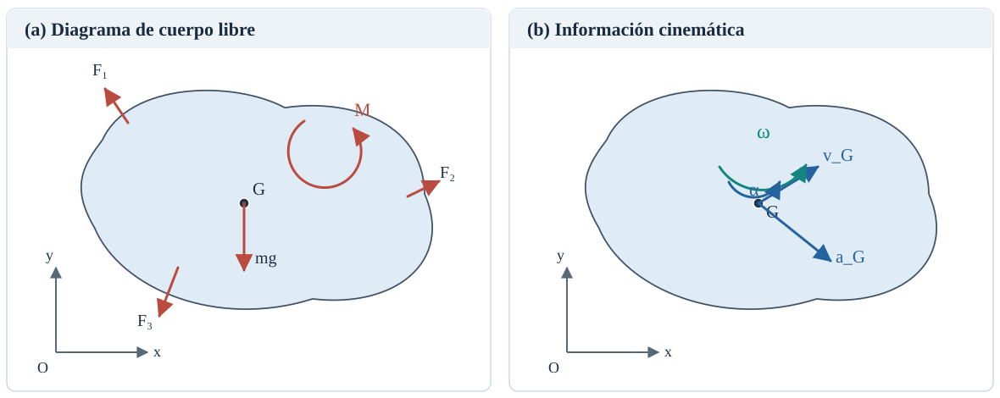
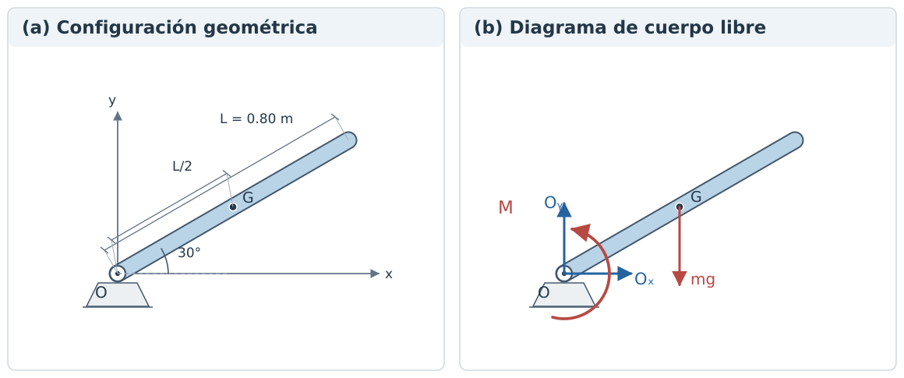
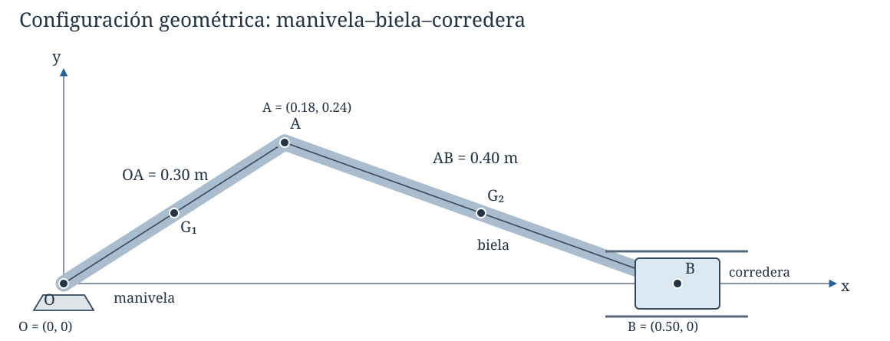
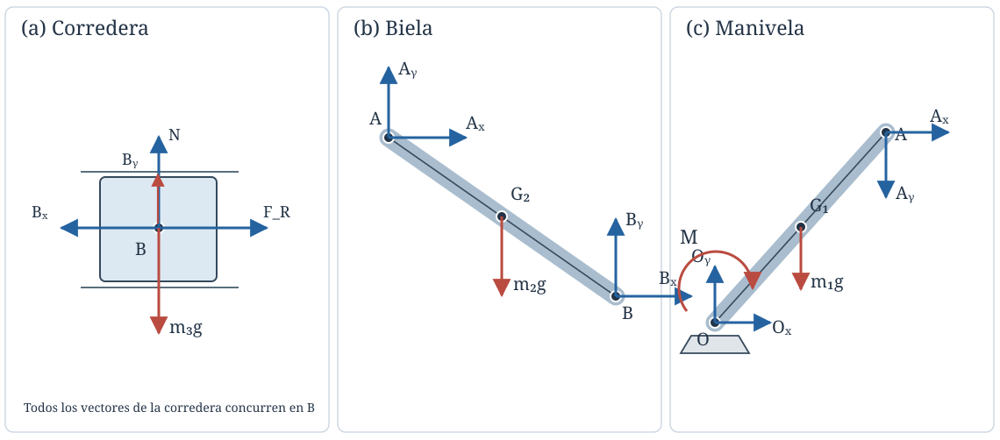

# Cinética del cuerpo rígido

## 1. Fundamentos de la cinética del cuerpo rígido

### 1.1. De la cinemática a la cinética

La **dinámica** es la rama de la mecánica que estudia el movimiento de los cuerpos y su relación con las fuerzas y momentos que actúan sobre ellos. Tradicionalmente, su estudio se divide en dos partes:

- **Cinemática:** describe el movimiento de los cuerpos mediante variables como posición, velocidad y aceleración, sin considerar las fuerzas que lo producen.
- **Cinética:** establece las relaciones entre el movimiento de los cuerpos y las fuerzas y momentos que actúan sobre ellos.

En el análisis cinemático de mecanismos estudiamos cómo se mueven sus eslabones a partir de la geometría del sistema y de las restricciones impuestas por las articulaciones. Sin embargo, conocer el movimiento de un mecanismo no nos indica directamente qué fuerzas se desarrollan en sus articulaciones o qué par debe proporcionar un motor para producir dicho movimiento.

Para responder estas preguntas es necesario incorporar la cinética.

### 1.2. El modelo de cuerpo rígido

Un **cuerpo rígido** es un modelo idealizado de un cuerpo cuyas partículas mantienen distancias relativas constantes, incluso cuando está sometido a fuerzas y momentos. Esta idealización permite estudiar el movimiento sin considerar las deformaciones del material.

Para el análisis cinético de un cuerpo rígido es necesario conocer, además de su movimiento, algunas de sus propiedades de masa:

- **Masa, $m$:** cuantifica la inercia traslacional del cuerpo.
- **Centro de masa, $G$:** punto cuyo movimiento permite describir la respuesta traslacional del cuerpo a las fuerzas externas.
- **Momento de inercia de masa, $I$:** caracteriza la distribución de masa respecto a un eje y su resistencia a experimentar aceleración angular alrededor de dicho eje.

Estas propiedades permiten relacionar las fuerzas y momentos externos con las aceleraciones del cuerpo.

En estos apuntes nos concentraremos en cuerpos rígidos con **movimiento plano**, es decir, aquellos cuyo movimiento ocurre en planos paralelos a uno fijo.

### 1.3. Fuerzas y momentos externos

En el análisis cinético es necesario identificar las **acciones externas** que actúan sobre el cuerpo. En un eslabón de un mecanismo pueden incluir el peso, las fuerzas de contacto, las reacciones en las articulaciones y los pares aplicados por actuadores.

Recordemos que el momento de una fuerza $\mathbf F$ respecto a un punto $O$ se calcula mediante

$$
\mathbf M_O=\mathbf r_{P/O}\times\mathbf F
$$

donde $\mathbf r_{P/O}$ es el vector que va desde $O$ hasta un punto $P$ de la línea de acción de la fuerza.

Además de los momentos producidos por fuerzas, sobre un cuerpo pueden actuar **pares aplicados**, como el par que transmite un motor. En el movimiento plano, los momentos se representan mediante magnitudes escalares con signo, de acuerdo con una convención de sentidos.

Más adelante utilizaremos estas acciones para construir diagramas de cuerpo libre y formular las ecuaciones de movimiento.

### 1.4. Fundamento físico: leyes de Newton

La cinética clásica se fundamenta en las leyes del movimiento de Newton.

Para una partícula de masa constante, la segunda ley establece que la resultante de las fuerzas externas es igual al producto de su masa por su aceleración:

$$
\sum \mathbf F=m\mathbf a
$$

Esta ecuación expresa la relación entre las fuerzas aplicadas y el cambio en el movimiento de la partícula.

Sin embargo, un cuerpo rígido no puede describirse únicamente como una partícula, ya que además de trasladarse puede experimentar movimiento de rotación.

Por tanto, para estudiar su cinética necesitaremos establecer dos relaciones fundamentales:

1. Una relación entre las fuerzas externas y el movimiento del centro de masa.
2. Una relación entre los momentos externos y el movimiento de rotación del cuerpo.

Estas relaciones se obtienen aplicando los principios de Newton al sistema de partículas que constituye el cuerpo rígido. Después de estudiar las propiedades de masa, deduciremos estas relaciones en la [sección de ecuaciones de movimiento](#ecuaciones-de-movimiento).

### 1.5. Dinámica directa e inversa

Al estudiar la dinámica de un sistema mecánico pueden plantearse dos tipos de problemas.

**Dinámica directa.** Se conocen las fuerzas y momentos aplicados al sistema y se busca determinar el movimiento resultante. Por ejemplo, conocer el par aplicado a un eslabón y determinar su aceleración angular.

**Dinámica inversa.** Se conoce el movimiento del sistema y se busca determinar las fuerzas y momentos necesarios para producirlo. Por ejemplo, conocer la aceleración angular de un eslabón y calcular el par que debe proporcionar un motor.

En el análisis de mecanismos, la dinámica inversa tiene especial importancia porque frecuentemente conocemos las posiciones, velocidades y aceleraciones de los eslabones mediante el análisis cinemático, y deseamos determinar las fuerzas de reacción y los pares de accionamiento correspondientes.

Así, el análisis cinético complementa al análisis cinemático y permite avanzar hacia el estudio dinámico de mecanismos completos.

(propiedades-de-masa)=
## 2. Propiedades de masa del cuerpo rígido

Las propiedades de masa permiten describir cómo está distribuida la materia de un cuerpo y desempeñan un papel fundamental en su análisis dinámico. En esta sección estudiaremos el **centro de masa** y el **momento de inercia de masa**, con énfasis en los cuerpos y eslabones que intervienen en mecanismos planos.

### 2.1. Centro de masa

El centro de masa permite representar la distribución de masa de un cuerpo mediante un punto característico. Su posición resulta de especial interés porque la resultante de las fuerzas externas determina la aceleración de ese punto, como veremos al estudiar las ecuaciones de movimiento de Newton–Euler.

#### 2.1.1. Concepto de centro de masa

Consideremos un cuerpo cuya masa está distribuida en el espacio. Aunque sus partículas ocupan posiciones diferentes, podemos identificar un punto $G$ que caracteriza la distribución de masa del conjunto: el **centro de masa**.

La posición de $G$ depende tanto de la geometría como de la manera en que se distribuye la masa. Por ejemplo, si una región de un cuerpo concentra una mayor cantidad de masa, el centro de masa tiende a localizarse más cerca de ella.

Es importante distinguir tres conceptos relacionados:

- **Centro de masa:** punto determinado por la distribución de masa del cuerpo.
- **Centroide geométrico:** punto asociado a una distribución geométrica de longitud, área o volumen, independientemente de la masa.
- **Centro de gravedad:** punto de aplicación equivalente de la resultante de las fuerzas gravitatorias cuando dicha resultante puede representarse de ese modo.

En un cuerpo homogéneo, el centro de masa coincide con el centroide de la geometría correspondiente. Además, cuando el campo gravitatorio es uniforme, el centro de gravedad coincide con el centro de masa.

> **Observación.** El centro de masa no necesariamente se encuentra dentro del material del cuerpo. Por ejemplo, el centro de masa de un aro circular homogéneo está en su centro geométrico, donde no hay material.

#### 2.1.2. Centro de masa de un sistema de partículas

Supongamos que un sistema está constituido por $n$ partículas de masas $m_1,m_2,\ldots,m_n$, cuyas posiciones respecto a un origen $O$ se describen mediante los vectores $\mathbf r_1,\mathbf r_2,\ldots,\mathbf r_n$.

La masa total del sistema es

$$
m=\sum_{i=1}^{n}m_i
$$

La posición del centro de masa se define como el **promedio de las posiciones ponderado por las masas**:

$$
\boxed{
\mathbf r_G=\frac{1}{m}\sum_{i=1}^{n}m_i\mathbf r_i
}
$$

Esta definición puede escribirse también como

$$
m\mathbf r_G=\sum_{i=1}^{n}m_i\mathbf r_i
$$

El término $m_i\mathbf r_i$ constituye el *primer momento de masa* de la partícula $i$ respecto al origen elegido. Así, la suma de los primeros momentos de masa del sistema equivale al primer momento de toda su masa concentrada en $G$.

**Interpretación mediante posiciones relativas.** Si definimos el vector desde $G$ hasta la partícula $i$ mediante nuestra notación habitual,

$$
\mathbf r_{i/G}=\mathbf r_i-\mathbf r_G
$$

se cumple que

$$
\begin{aligned}
\sum_{i=1}^{n}m_i\mathbf r_{i/G}
&=\sum_{i=1}^{n}m_i(\mathbf r_i-\mathbf r_G)\\
&=\sum_{i=1}^{n}m_i\mathbf r_i-m\mathbf r_G\\
&=\mathbf 0
\end{aligned}
$$

Por tanto,

$$
\boxed{\sum_{i=1}^{n}m_i\mathbf r_{i/G}=\mathbf 0}
$$

Esta propiedad expresa que los primeros momentos de masa respecto al centro de masa se compensan entre sí; también será útil al deducir las ecuaciones de movimiento del cuerpo rígido.

En coordenadas cartesianas, la definición vectorial equivale a

$$
\boxed{
\begin{aligned}
x_G&=\frac{\sum_i m_i x_i}{m}\\
y_G&=\frac{\sum_i m_i y_i}{m}\\
z_G&=\frac{\sum_i m_i z_i}{m}
\end{aligned}
}
$$

Para los problemas planos bastará utilizar las componentes $x_G$ y $y_G$.

**Ejemplo breve.** Dos partículas se encuentran sobre el eje $x$: $m_1=1\ \mathrm{kg}$ en $x_1=0$ y $m_2=3\ \mathrm{kg}$ en $x_2=0.40\ \mathrm m$. Su centro de masa está en

$$
x_G=\frac{1(0)+3(0.40)}{1+3}=0.30\ \mathrm m
$$

Como cabría esperar, $G$ queda más cerca de la partícula de mayor masa.

#### 2.1.3. Centro de masa de cuerpos continuos

Un cuerpo real contiene una distribución continua de materia. Para determinar su centro de masa, podemos dividirlo conceptualmente en elementos diferenciales de masa $dm$.

Al pasar del sistema discreto a una distribución continua, la suma se convierte en una integral:

$$
\boxed{
\mathbf r_G=\frac{1}{m}\int_m\mathbf r\,dm
},
\qquad
m=\int_m dm
$$

En coordenadas cartesianas,

$$
\boxed{
\begin{aligned}
x_G&=\frac{1}{m}\int_m x\,dm\\
y_G&=\frac{1}{m}\int_m y\,dm\\
z_G&=\frac{1}{m}\int_m z\,dm
\end{aligned}
}
$$

Para evaluar estas integrales necesitamos expresar $dm$ en términos de la geometría y de la densidad de masa. Según el modelo utilizado, podemos escribir:

| Tipo de distribución | Elemento de masa | Densidad |
| --- | --- | --- |
| Lineal, como una barra delgada | $dm=\lambda\,ds$ | $\lambda$: masa por unidad de longitud |
| Superficial, como una placa delgada | $dm=\sigma\,dA$ | $\sigma$: masa por unidad de área |
| Volumétrica, como un sólido | $dm=\rho\,dV$ | $\rho$: masa por unidad de volumen |

Las densidades pueden depender de la posición. Cuando la distribución es **homogénea**, la densidad correspondiente es constante y se cancela entre el numerador y el denominador de la expresión del centro de masa. Por ejemplo, para una placa delgada homogénea,

$$
x_G=\frac{\int_A x\,dA}{\int_A dA},
\qquad
y_G=\frac{\int_A y\,dA}{\int_A dA}
$$

En este caso, el cálculo coincide con la determinación del centroide geométrico del área.

#### 2.1.4. Simetría y simplificaciones

Antes de realizar una suma o una integral, conviene examinar si la distribución de masa presenta alguna simetría.

En una distribución plana, si la geometría **y la distribución de densidad** son simétricas respecto a un eje, el centro de masa debe encontrarse sobre ese eje. Cuando existen dos ejes de simetría que se intersectan, su punto de intersección determina la posición de $G$ en el plano.

Por ejemplo, el centro de masa de una barra delgada homogénea de longitud $L$ se encuentra en su punto medio:

$$
x_G=\frac{L}{2}
$$

si uno de sus extremos se toma como origen y el eje $x$ sigue la dirección de la barra. Del mismo modo, el centro de masa de una placa circular homogénea coincide con su centro geométrico.

La simetría geométrica por sí sola no es suficiente si la densidad varía de manera asimétrica: un cuerpo de forma simétrica puede tener su centro de masa desplazado hacia la región más pesada.

**Relación con los mecanismos.** Al analizar un eslabón, conocer $G$ permite ubicar su peso en un campo gravitatorio uniforme y determinar la aceleración de su centro de masa a partir de las relaciones cinemáticas. En las secciones siguientes estudiaremos otra propiedad complementaria —el momento de inercia de masa— y después aprenderemos a calcular ambas propiedades en cuerpos compuestos.

### 2.2. Momento de inercia de masa

En la sección anterior determinamos la posición del centro de masa, que caracteriza la distribución de masa de un cuerpo mediante un punto. Sin embargo, para estudiar su movimiento de rotación necesitamos otra propiedad: el **momento de inercia de masa** respecto a un eje.

#### 2.2.1. Interpretación física

La masa cuantifica la inercia asociada al movimiento de traslación. En el movimiento de rotación, además de la cantidad de masa, importa **a qué distancia del eje de rotación se encuentra distribuida**.

Consideremos dos cuerpos con la misma masa total, pero distribuciones diferentes respecto a un eje. Si una mayor proporción de su masa se encuentra lejos de ese eje, el cuerpo tendrá un momento de inercia mayor. En consecuencia, para una misma aceleración angular alrededor de un eje fijo, será necesario aplicar un momento resultante mayor, si las demás condiciones son equivalentes.

Esta dependencia de la distancia es cuadrática: una partícula situada a una distancia $2r$ de un eje contribuye cuatro veces más al momento de inercia que otra partícula de la misma masa situada a una distancia $r$.

> **Importante.** El momento de inercia de masa es una **propiedad del cuerpo respecto a un eje determinado**. Por ello, un mismo cuerpo puede tener distintos momentos de inercia cuando se consideran ejes diferentes.

#### 2.2.2. Definición matemática

Consideremos un sistema de $n$ partículas. Sea $r_i$ la **distancia perpendicular** desde la partícula $i$ hasta el eje considerado. El momento de inercia de masa del sistema respecto a ese eje se define mediante

$$
\boxed{I=\sum_{i=1}^{n}m_i r_i^{\,2}}
$$

Para una distribución continua de masa, esta expresión se convierte en

$$
\boxed{I=\int_m r^2\,dm}
$$

donde $dm$ representa un elemento diferencial de masa y $r$ es la **distancia perpendicular** desde ese elemento hasta el eje respecto al cual se calcula el momento de inercia. Aquí $r$ es una distancia escalar, que no debe confundirse con un vector de posición como $\mathbf r_i$.

En el Sistema Internacional, el momento de inercia de masa se expresa en $\mathrm{kg\,m^2}$.

**Momentos de inercia respecto a ejes cartesianos.** Si los ejes $x$, $y$ y $z$ de un sistema cartesiano son los ejes respecto a los que deseamos calcular el momento de inercia, entonces

$$
\begin{aligned}
I_x&=\int_m(y^2+z^2)\,dm\\
I_y&=\int_m(x^2+z^2)\,dm\\
I_z&=\int_m(x^2+y^2)\,dm
\end{aligned}
$$

Cada expresión utiliza la distancia perpendicular al eje correspondiente. Así, para el eje $z$, esa distancia satisface $r^2=x^2+y^2$.

**Especialización a mecanismos planos.** En un mecanismo cuyo movimiento ocurre en el plano $xy$, nos interesa principalmente el momento de inercia respecto a un eje paralelo a $z$, perpendicular al plano del movimiento.

Si dicho eje pasa por el centro de masa $G$, emplearemos la notación $I_G$:

$$
\boxed{
I_G=\int_m\left[(x-x_G)^2+(y-y_G)^2\right]\,dm
}
$$

De manera equivalente, para un sistema de partículas,

$$
I_G=\sum_{i=1}^{n}m_i
\left(x_{i/G}^{\,2}+y_{i/G}^{\,2}\right)
$$

Aquí $x_{i/G}$ y $y_{i/G}$ son las componentes del vector relativo $\mathbf r_{i/G}$ definido en la sección anterior. La abreviatura $I_G$ siempre se referirá, en nuestro estudio del movimiento plano, al eje perpendicular al plano que pasa por $G$.

La importancia dinámica de esta propiedad aparecerá en las [ecuaciones de Newton–Euler para movimiento plano](#ecuaciones-de-movimiento), donde se utiliza la relación

$$
\sum M_G=I_G\alpha
$$

No es necesario extender esta relación escalar a la rotación tridimensional general: en ese caso, la descripción completa de la inercia rotacional requiere considerar también cómo se distribuye la masa respecto a distintas direcciones.

#### 2.2.3. Cálculo por integración: barra delgada homogénea

Calculemos el momento de inercia de masa de una **barra delgada y homogénea**, de masa $m$ y longitud $L$, respecto al eje perpendicular al plano $xy$ que pasa por su centro de masa $G$.

Tomemos el eje $x$ sobre la barra, con el origen en $G$. Por simetría, sus extremos se encuentran en $x=-L/2$ y $x=L/2$.

**Paso 1. Definir el elemento de masa.** Al ser homogénea, la barra tiene densidad lineal constante

$$
\lambda=\frac{m}{L}
$$

Por tanto, un segmento diferencial de longitud $dx$ tiene una masa

$$
dm=\lambda\,dx=\frac{m}{L}\,dx
$$

**Paso 2. Expresar la distancia al eje.** Para el elemento situado en la coordenada $x$, la distancia perpendicular al eje que pasa por $G$ es $r=|x|$, de modo que $r^2=x^2$.

**Paso 3. Plantear e integrar.** Sustituyendo en la definición,

$$
\begin{aligned}
I_G
&=\int_m x^2\,dm\\
&=\frac{m}{L}\int_{-L/2}^{L/2}x^2\,dx\\
&=\frac{m}{L}\left[\frac{x^3}{3}\right]_{-L/2}^{L/2}\\
&=\frac{m}{L}\left(\frac{L^3}{12}\right)
\end{aligned}
$$

Finalmente,

$$
\boxed{I_G=\frac{1}{12}mL^2}
$$

Esta expresión es válida en el **modelo de barra delgada** y para el eje especificado. Si el cuerpo tiene dimensiones transversales relevantes, su momento de inercia debe calcularse considerando la distribución tridimensional de masa.

**Ejemplo numérico.** Para una barra con $m=3\ \mathrm{kg}$ y $L=0.80\ \mathrm m$,

$$
I_G=\frac{1}{12}(3)(0.80)^2
=\boxed{0.16\ \mathrm{kg\,m^2}}
$$

Este valor corresponde al eje perpendicular que pasa por $G$. Si se requiere el momento de inercia respecto al eje de una articulación situada en un extremo, el resultado será distinto. En el apartado 2.3 estudiaremos cómo relacionar ambos mediante el **teorema de ejes paralelos**.

#### 2.2.4. Radio de giro

El **radio de giro** $k$ respecto a un eje se define como la distancia a la cual podría concentrarse idealmente toda la masa del cuerpo para obtener el mismo momento de inercia respecto a ese eje:

$$
I=mk^2
$$

Despejando,

$$
\boxed{k=\sqrt{\frac{I}{m}}}
$$

El radio de giro tiene unidades de longitud y sirve como medida de la distribución de masa respecto al eje. **No debe confundirse con la distancia del centro de masa al eje:** aun cuando el eje pasa por $G$, el radio de giro es generalmente distinto de cero.

Para la barra delgada homogénea estudiada anteriormente,

$$
k_G=\sqrt{\frac{I_G}{m}}
=\sqrt{\frac{L^2}{12}}
=\boxed{\frac{L}{\sqrt{12}}}
$$

Para $L=0.80\ \mathrm m$, resulta $k_G\approx 0.231\ \mathrm m$.

> **Distinción de terminología.** El *momento de inercia de masa*, utilizado en dinámica, se expresa en $\mathrm{kg\,m^2}$. El *segundo momento de área*, frecuente en resistencia de materiales, se expresa en $\mathrm{m^4}$. Aunque sus expresiones matemáticas se parecen, corresponden a cantidades físicas diferentes.

**Relación con los mecanismos.** La masa $m$, la posición del centro de masa $G$ y el momento de inercia $I_G$ son datos esenciales para plantear las ecuaciones de movimiento de un eslabón plano. En la siguiente sección utilizaremos el teorema de ejes paralelos para obtener momentos de inercia respecto a otros ejes, como los que pasan por las articulaciones.

### 2.3. Teorema de ejes paralelos

El momento de inercia de masa depende del eje respecto al cual se calcula. En muchos problemas de mecanismos conocemos el momento de inercia de un eslabón respecto al eje que pasa por su centro de masa, pero necesitamos determinarlo respecto al eje de una articulación.

El **teorema de ejes paralelos**, también conocido como teorema de Steiner, permite relacionar ambas cantidades sin repetir la integración sobre toda la distribución de masa.

#### 2.3.1. Formulación del teorema

Consideremos un cuerpo de masa $m$ y dos **ejes paralelos**: uno que pasa por el centro de masa $G$ y otro que pasa por un punto $O$. Sea $d$ la distancia perpendicular entre ambos ejes.

El teorema establece que

$$
\boxed{I_O=I_G+md^2}
$$

donde:

- $I_G$ es el momento de inercia de masa respecto al eje que pasa por $G$.
- $I_O$ es el momento de inercia de masa respecto al eje paralelo que pasa por $O$.
- $d$ es la distancia perpendicular entre los dos ejes.
- $m$ es la masa total del cuerpo.

En el **movimiento plano** que estudiaremos, ambos ejes son perpendiculares al plano del movimiento. Si $O$ y $G$ se ubican en dicho plano, entonces $d$ coincide con la distancia entre esos puntos:

$$
d^2=(x_G-x_O)^2+(y_G-y_O)^2
$$

Como $md^2\geq 0$, el momento de inercia respecto al eje que pasa por $G$ es el **mínimo entre los momentos de inercia respecto a los ejes paralelos a él**, y la igualdad ocurre cuando ambos ejes coinciden.

> **Condición esencial.** Los ejes deben ser paralelos, y uno de ellos debe pasar por el centro de masa del cuerpo. No puede utilizarse la expresión $I_O=I_P+md^2$ entre dos ejes arbitrarios sólo porque sean paralelos.

#### 2.3.2. Deducción para ejes perpendiculares al plano

Retomemos el modelo de un sistema de $n$ partículas, con posiciones $(x_i,y_i)$ medidas desde $O$. Sea $(x_G,y_G)$ la posición del centro de masa respecto al mismo origen. Entonces podemos escribir las componentes de la posición relativa como

$$
x_{i/G}=x_i-x_G,
\qquad
y_{i/G}=y_i-y_G
$$

Por tanto,

$$
x_i=x_G+x_{i/G},
\qquad
y_i=y_G+y_{i/G}
$$

El momento de inercia respecto al eje perpendicular al plano que pasa por $O$ es

$$
I_O=\sum_{i=1}^{n}m_i(x_i^2+y_i^2)
$$

Al sustituir las expresiones anteriores y desarrollar los cuadrados:

$$
\begin{aligned}
I_O
={}&\sum_{i=1}^{n}m_i(x_{i/G}^2+y_{i/G}^2)\\
&+2x_G\sum_{i=1}^{n}m_i x_{i/G}
+2y_G\sum_{i=1}^{n}m_i y_{i/G}\\
&+(x_G^2+y_G^2)\sum_{i=1}^{n}m_i
\end{aligned}
$$

El primer término es precisamente $I_G$. Los dos términos intermedios se anulan, porque en el apartado 2.1 demostramos que

$$
\sum_{i=1}^{n}m_i\mathbf r_{i/G}=\mathbf 0
$$

Por último, $\sum_i m_i=m$ y, con el origen situado en $O$, se cumple $x_G^2+y_G^2=d^2$. Así obtenemos

$$
I_O=I_G+0+0+md^2
$$

es decir,

$$
\boxed{I_O=I_G+md^2}
$$

La deducción se extiende directamente a cuerpos con distribución continua de masa, sustituyendo las sumatorias por integrales. El hecho fundamental es el mismo: **los primeros momentos de masa respecto a $G$ son nulos**.

#### 2.3.3. Aplicación: barra homogénea articulada en un extremo

En el apartado 2.2 calculamos el momento de inercia de una barra delgada homogénea, de masa $m$ y longitud $L$, respecto al eje perpendicular al plano que pasa por su centro de masa:

$$
I_G=\frac{1}{12}mL^2
$$

Supongamos ahora que la barra está unida a una articulación en uno de sus extremos, al que llamaremos $O$. El centro de masa se encuentra en el punto medio de la barra, por lo que la distancia entre el eje de $O$ y el eje paralelo de $G$ es

$$
d=\frac{L}{2}
$$

Aplicando el teorema de ejes paralelos,

$$
\begin{aligned}
I_O
&=I_G+md^2\\
&=\frac{1}{12}mL^2+m\left(\frac{L}{2}\right)^2\\
&=\left(\frac{1}{12}+\frac{1}{4}\right)mL^2
\end{aligned}
$$

Por tanto,

$$
\boxed{I_O=\frac{1}{3}mL^2}
$$

**Ejemplo numérico.** Utilicemos la misma barra de la sección anterior, con $m=3\ \mathrm{kg}$ y $L=0.80\ \mathrm m$. Sabemos que $I_G=0.16\ \mathrm{kg\,m^2}$ y que $d=0.40\ \mathrm m$. Entonces,

$$
\begin{aligned}
I_O
&=0.16+3(0.40)^2\\
&=\boxed{0.64\ \mathrm{kg\,m^2}}
\end{aligned}
$$

El momento de inercia respecto al eje de la articulación es cuatro veces el correspondiente al eje paralelo que pasa por $G$.

**Conexión con Newton–Euler.** Si la barra gira alrededor de un **pivote fijo $O$** en un plano, el momento de inercia $I_O$ interviene en la ecuación

$$
\sum M_O=I_O\alpha
$$

Esta relación aparece en el [ejemplo de la barra con pivote fijo](#ejemplo-barra-pivote). Conviene distinguir dos afirmaciones: el teorema de ejes paralelos es una relación **geométrica de propiedades de masa**, válida independientemente del movimiento; en cambio, para utilizar la ecuación dinámica $\sum M_O=I_O\alpha$ en esta forma se requiere que $O$ sea un punto fijo de rotación en un sistema de referencia inercial.

En la siguiente sección utilizaremos el teorema para calcular el momento de inercia de **cuerpos compuestos**, a partir de los momentos de inercia de sus componentes.

### 2.4. Centro de masa y momento de inercia de cuerpos compuestos

En el diseño de mecanismos es habitual encontrar eslabones formados por varias regiones geométricas: placas con salientes, barras unidas entre sí o piezas con perforaciones. Si conocemos las propiedades de masa de figuras sencillas, podemos combinarlas para obtener las del cuerpo completo, **sin integrar nuevamente sobre toda su geometría**.

El procedimiento consiste en calcular primero la masa y el centro de masa del conjunto y, después, su momento de inercia respecto al eje deseado.

#### 2.4.1. Descomposición en componentes simples

Consideremos un cuerpo rígido que pueda representarse mediante $n$ componentes de geometría sencilla. Cada componente $i$ tiene:

- Masa $m_i$.
- Centro de masa $G_i$, situado en $(x_{G_i},y_{G_i})$ respecto a un mismo sistema de referencia.
- Momento de inercia $I_{G_i}$ respecto al eje perpendicular al plano que pasa por $G_i$.

Para comenzar su análisis, conviene identificar regiones **sin superposición**, de modo que ninguna porción de material se contabilice dos veces. Cuando sea más sencillo describir una pieza como una figura completa a la que se le retira material, podemos emplear el procedimiento de sustracción que estudiaremos en el apartado 2.4.4.

En una placa delgada homogénea, las masas se obtienen a partir del área de cada componente y de la densidad superficial común $\sigma$:

$$
m_i=\sigma A_i
$$

Si el espesor y la densidad volumétrica son uniformes, la densidad superficial puede expresarse como $\sigma=\rho t$, donde $t$ es el espesor. Si los componentes tienen materiales, espesores o densidades diferentes, **sus masas deben determinarse por separado**.

Algunas expresiones útiles para los componentes más habituales son:

| Componente homogéneo | Masa | Momento de inercia respecto al eje por $G_i$ |
| --- | --- | --- |
| Barra delgada de longitud $L$ | $m_i=\lambda L$ | $I_{G_i}=\frac{1}{12}m_iL^2$ |
| Placa rectangular de lados $b$ y $h$ | $m_i=\sigma bh$ | $I_{G_i}=\frac{1}{12}m_i(b^2+h^2)$ |
| Placa circular de radio $R$ | $m_i=\sigma\pi R^2$ | $I_{G_i}=\frac{1}{2}m_iR^2$ |

En todos los casos de la tabla, el eje es **perpendicular al plano de la figura** y pasa por el centro de masa correspondiente. Para utilizar las fórmulas es necesario que el componente se ajuste a la idealización geométrica indicada.

#### 2.4.2. Centro de masa del cuerpo compuesto

Si todos los componentes representan material presente, la masa total es

$$
m=\sum_{i=1}^{n}m_i
$$

La posición del centro de masa $G$ del conjunto se obtiene sumando los primeros momentos de masa de sus componentes:

$$
\boxed{
\mathbf r_G=\frac{1}{m}\sum_{i=1}^{n}m_i\mathbf r_{G_i}
}
$$

Para una distribución plana, esta relación toma la forma

$$
\boxed{
\begin{aligned}
x_G&=\frac{\sum_{i=1}^{n}m_i x_{G_i}}{\sum_{i=1}^{n}m_i}\\
y_G&=\frac{\sum_{i=1}^{n}m_i y_{G_i}}{\sum_{i=1}^{n}m_i}
\end{aligned}
}
$$

Aquí $\mathbf r_{G_i}$ es el vector de posición del centro de masa del componente $i$ respecto al origen elegido.

Si todos los componentes son placas con la **misma densidad superficial**, el factor $\sigma$ se cancela y podemos trabajar directamente con sus áreas:

$$
x_G=\frac{\sum_i A_i x_{G_i}}{\sum_i A_i},
\qquad
y_G=\frac{\sum_i A_i y_{G_i}}{\sum_i A_i}
$$

Esta última simplificación **no debe emplearse** si los componentes tienen distintas densidades superficiales, incluso cuando estén hechos de figuras geométricas semejantes.

#### 2.4.3. Momento de inercia respecto al centro de masa del conjunto

Una vez localizado $G$, necesitamos determinar el momento de inercia del cuerpo completo respecto al eje perpendicular al plano que pasa por ese punto.

Para cada componente conocemos $I_{G_i}$, pero el eje que pasa por $G_i$ generalmente **no coincide** con el eje que pasa por $G$. Aplicamos entonces el teorema de ejes paralelos a cada componente:

$$
I_{G}^{(i)}=I_{G_i}+m_i d_i^2
$$

donde $I_{G}^{(i)}$ es la contribución del componente $i$ respecto al eje que pasa por el centro de masa del conjunto, y

$$
d_i^2=(x_{G_i}-x_G)^2+(y_{G_i}-y_G)^2
$$

es el cuadrado de la distancia entre los centros de masa. En nuestra notación vectorial, el desplazamiento correspondiente es

$$
\mathbf r_{G_i/G}=\mathbf r_{G_i}-\mathbf r_G
$$

Al sumar las contribuciones de todos los componentes obtenemos

$$
\boxed{
I_G=\sum_{i=1}^{n}\left[
I_{G_i}+m_i\left((x_{G_i}-x_G)^2+(y_{G_i}-y_G)^2\right)
\right]
}
$$

La expresión muestra que intervienen **dos aportaciones por componente**: su momento de inercia respecto al propio centro de masa y el término asociado al desplazamiento entre $G_i$ y $G$.

> **Error frecuente.** No basta con sumar los momentos de inercia $I_{G_i}$ de los componentes. Antes de sumarlos, todos deben estar referidos a un **mismo eje**.

Si finalmente necesitamos el momento de inercia respecto a un eje paralelo que pasa por una articulación $O$, podemos trasladar el momento de inercia del cuerpo completo:

$$
\boxed{
I_O=I_G+m\left[(x_G-x_O)^2+(y_G-y_O)^2\right]
}
$$

Otra posibilidad es trasladar directamente cada contribución al eje de $O$ y sumarlas. Ambos procedimientos deben proporcionar el mismo resultado.

#### 2.4.4. Perforaciones y regiones de material removido

Es frecuente que un eslabón contenga orificios, ranuras u otras regiones sin material. Cuando conocemos la geometría y las propiedades de la pieza original, podemos calcular las propiedades del cuerpo restante **restando las contribuciones correspondientes al material removido**.

La idea es sencilla: una perforación se trata como si inicialmente estuviera ocupada por material y, después, se resta su **masa**, su **primer momento de masa** y su **momento de inercia respecto al eje considerado**.

**Ejemplo de formulación.** Supongamos que una placa se representa mediante dos regiones con material, $1$ y $2$, y una perforación $h$. La masa total es

$$
m=m_1+m_2-m_h
$$

y las coordenadas de su centro de masa se obtienen mediante

$$
\boxed{
x_G=\frac{m_1x_{G_1}+m_2x_{G_2}-m_hx_{G_h}}{m},
\qquad
y_G=\frac{m_1y_{G_1}+m_2y_{G_2}-m_hy_{G_h}}{m}
}
$$

Una vez localizado $G$, trasladamos **cada contribución al mismo eje perpendicular al plano que pasa por $G$**. Entonces,

$$
\begin{aligned}
I_G
={}&(I_{G_1}+m_1d_1^2)
+(I_{G_2}+m_2d_2^2)\\
&-(I_{G_h}+m_hd_h^2)
\end{aligned}
$$

donde $d_1$, $d_2$ y $d_h$ son las distancias entre los centros de las regiones correspondientes y el centro de masa $G$ del cuerpo restante.

> **Importante.** La perforación es una contribución negativa **sólo en el procedimiento algebraico**; su masa $m_h$ y su momento de inercia $I_{G_h}$ se calculan como magnitudes positivas, usando la densidad del material que habría ocupado esa región. No existe una masa física negativa.

Este recurso funciona siempre que la descomposición represente correctamente el material presente y las regiones retiradas, sin duplicar material ni restar dos veces una misma perforación. Si intervienen distintos materiales o espesores, debemos calcular las propiedades de cada región con la densidad correspondiente.

#### 2.4.5. Procedimiento de cálculo mediante una tabla

Una tabla ayuda a organizar los datos, especialmente cuando el cuerpo contiene varias regiones. Podemos emplear la siguiente estructura:

| Región | Tipo | Masa | $x_{G_i}$ | $y_{G_i}$ | $I_{G_i}$ |
| --- | --- | ---: | ---: | ---: | ---: |
| Componente 1 | Material | $m_1$ | $x_{G_1}$ | $y_{G_1}$ | $I_{G_1}$ |
| Componente 2 | Material | $m_2$ | $x_{G_2}$ | $y_{G_2}$ | $I_{G_2}$ |
| Región $h$ | Perforación | $m_h$ | $x_{G_h}$ | $y_{G_h}$ | $I_{G_h}$ |

**Todas las masas y momentos de inercia de la tabla se registran como magnitudes positivas.** Durante el cálculo, las regiones marcadas como perforaciones se restan.

A partir de estos datos procedemos en el siguiente orden:

1. **Masa total:** sumar las masas del material presente y restar las de las perforaciones; comprobar que $m>0$.
2. **Centro de masa:** sumar los primeros momentos de masa del material y restar los correspondientes a las perforaciones, dividiendo entre la masa total real.
3. **Distancias entre centros:** determinar $d_i^2=(x_{G_i}-x_G)^2+(y_{G_i}-y_G)^2$ para cada región, una vez localizado $G$.
4. **Momento de inercia:** trasladar las contribuciones de todas las regiones al eje que pasa por $G$ y sumar las del material, restando las de las perforaciones.
5. **Cambio de eje, si se requiere:** aplicar el teorema de ejes paralelos desde $G$ hasta el eje de interés.

Como verificación, los primeros momentos de masa respecto al centro de masa deben compensarse. Por ejemplo, en la placa de dos componentes y una perforación:

$$
\begin{aligned}
m_1(x_{G_1}-x_G)+m_2(x_{G_2}-x_G)-m_h(x_{G_h}-x_G)&=0\\
m_1(y_{G_1}-y_G)+m_2(y_{G_2}-y_G)-m_h(y_{G_h}-y_G)&=0
\end{aligned}
$$

También debemos comprobar que las unidades sean consistentes: las masas se expresan en $\mathrm{kg}$, las coordenadas en $\mathrm m$ y los momentos de inercia de masa en $\mathrm{kg\,m^2}$.

**Conexión con mecanismos.** El procedimiento permite obtener las propiedades $m$, $G$ e $I_G$ de un eslabón de geometría compuesta. En la siguiente sección lo aplicaremos a un **eslabón plano**, calculando después su momento de inercia respecto al eje de una articulación. Estos datos podrán utilizarse directamente en las ecuaciones de Newton–Euler.

### 2.5. Aplicación a mecanismos: propiedades de masa de un eslabón compuesto

En las secciones anteriores estudiamos cómo localizar el centro de masa y calcular el momento de inercia de un cuerpo. A continuación aplicaremos ambos procedimientos a un **eslabón plano de geometría compuesta**. El objetivo es obtener las propiedades que posteriormente necesitaremos para plantear sus ecuaciones de movimiento.

#### 2.5.1. Planteamiento y descomposición geométrica

Consideremos un eslabón fabricado a partir de una **placa delgada, homogénea y con forma de L**, de densidad superficial constante

$$
\sigma=50\ \mathrm{kg/m^2}
$$

Tomemos el punto $O=(0,0)$ en la esquina inferior izquierda de la placa y los ejes $x$ y $y$ a lo largo de sus bordes horizontal y vertical, respectivamente. Para representar la L utilizaremos dos regiones rectangulares **sin superposición de áreas**:

- **Región 1 (horizontal):** $0\leq x\leq 0.60\ \mathrm m$ y $0\leq y\leq 0.12\ \mathrm m$.
- **Región 2 (vertical):** $0\leq x\leq 0.12\ \mathrm m$ y $0.12\ \mathrm m\leq y\leq 0.48\ \mathrm m$.

De esta manera, el rectángulo envolvente de la pieza mide $0.60\times 0.48\ \mathrm m$. Ambas regiones comparten una frontera, pero **ninguna porción de área se cuenta dos veces**.

Supondremos que el eslabón puede articularse idealmente alrededor de un eje perpendicular al plano que pasa por $O$. La posible remoción de material para alojar un perno no se considera en este primer modelo.

Calcularemos la masa total $m$, la posición del centro de masa $G$, el momento de inercia $I_G$ respecto al eje perpendicular al plano que pasa por $G$ y el momento de inercia $I_O$ respecto al eje paralelo que pasa por $O$.

#### 2.5.2. Masa total y posición del centro de masa

Primero determinamos las áreas, las masas y las coordenadas de los centros de cada rectángulo. Para una placa homogénea, $m_i=\sigma A_i$ y el centro de masa de cada región coincide con su centro geométrico.

| Región | Área ($\mathrm{m^2}$) | Masa ($\mathrm{kg}$) | $G_i=(x_{G_i},y_{G_i})$ ($\mathrm m$) |
| --- | ---: | ---: | ---: |
| 1. Horizontal | $0.0720$ | $3.60$ | $(0.30,\ 0.06)$ |
| 2. Vertical | $0.0432$ | $2.16$ | $(0.06,\ 0.30)$ |

La masa total resulta

$$
m=m_1+m_2=3.60+2.16=\boxed{5.76\ \mathrm{kg}}
$$

Para la coordenada horizontal del centro de masa:

$$
\begin{aligned}
x_G
&=\frac{m_1x_{G_1}+m_2x_{G_2}}{m}\\
&=\frac{3.60(0.30)+2.16(0.06)}{5.76}\\
&=\boxed{0.21\ \mathrm m}
\end{aligned}
$$

De manera análoga, para la coordenada vertical:

$$
\begin{aligned}
y_G
&=\frac{m_1y_{G_1}+m_2y_{G_2}}{m}\\
&=\frac{3.60(0.06)+2.16(0.30)}{5.76}\\
&=\boxed{0.15\ \mathrm m}
\end{aligned}
$$

Por tanto, respecto al origen $O$,

$$
\boxed{G=(0.21,\ 0.15)\ \mathrm m}
$$

**Observación física.** En esta configuración, el centro de masa queda en la región interior vacía de la L, porque $x_G>0.12\ \mathrm m$ y $y_G>0.12\ \mathrm m$. Esto no representa un error: el centro de masa de un cuerpo no tiene que coincidir con un punto ocupado por material.

#### 2.5.3. Momento de inercia respecto al centro de masa del conjunto

Para cada rectángulo utilizamos el momento de inercia respecto al eje perpendicular a su plano que pasa por su propio centro:

$$
I_{G_i}=\frac{1}{12}m_i(b_i^2+h_i^2)
$$

Así, para la región horizontal,

$$
I_{G_1}
=\frac{3.60}{12}\left(0.60^2+0.12^2\right)
=0.11232\ \mathrm{kg\,m^2}
$$

y para la región vertical,

$$
I_{G_2}
=\frac{2.16}{12}\left(0.12^2+0.36^2\right)
=0.02592\ \mathrm{kg\,m^2}
$$

Sin embargo, estos valores están referidos a **ejes diferentes**. Debemos trasladarlos al eje perpendicular al plano que pasa por el centro de masa $G$ del eslabón completo.

Los cuadrados de las distancias entre cada centro $G_i$ y el centro $G$ son

$$
\begin{aligned}
d_1^2
&=(0.30-0.21)^2+(0.06-0.15)^2
=0.0162\ \mathrm{m^2}\\
d_2^2
&=(0.06-0.21)^2+(0.30-0.15)^2
=0.0450\ \mathrm{m^2}
\end{aligned}
$$

Aplicando el teorema de ejes paralelos a ambos componentes y sumando sus contribuciones:

$$
\begin{aligned}
I_G
&=(I_{G_1}+m_1d_1^2)+(I_{G_2}+m_2d_2^2)\\
&=[0.11232+3.60(0.0162)]\\
&\quad+[0.02592+2.16(0.0450)]\\
&=\boxed{0.29376\ \mathrm{kg\,m^2}}
\end{aligned}
$$

#### 2.5.4. Momento de inercia respecto a la articulación

Supongamos que necesitamos conocer el momento de inercia respecto al eje que pasa por $O$. La distancia entre ese eje y el eje paralelo que pasa por $G$ satisface

$$
d_{G/O}^2=x_G^2+y_G^2
=0.21^2+0.15^2
=0.0666\ \mathrm{m^2}
$$

Por el teorema de ejes paralelos,

$$
\begin{aligned}
I_O
&=I_G+md_{G/O}^2\\
&=0.29376+5.76(0.0666)\\
&=\boxed{0.677376\ \mathrm{kg\,m^2}}
\end{aligned}
$$

**Comprobación independiente.** Podemos calcular el mismo resultado trasladando directamente cada componente al eje que pasa por $O$, sin utilizar previamente el centro de masa del conjunto:

$$
\begin{aligned}
I_O
={}&\left[I_{G_1}+m_1(x_{G_1}^2+y_{G_1}^2)\right]\\
&+\left[I_{G_2}+m_2(x_{G_2}^2+y_{G_2}^2)\right]\\
={}&\left[0.11232+3.60(0.30^2+0.06^2)\right]\\
&+\left[0.02592+2.16(0.06^2+0.30^2)\right]\\
={}&0.44928+0.228096\\
={}&\boxed{0.677376\ \mathrm{kg\,m^2}}
\end{aligned}
$$

Ambos procedimientos coinciden. Esta equivalencia constituye una buena verificación del cálculo y recuerda que **todas las contribuciones al momento de inercia deben referirse al mismo eje antes de sumarse**.

#### 2.5.5. Interpretación y conexión con el análisis dinámico

Las propiedades de masa obtenidas para el eslabón son

$$
\boxed{
\begin{aligned}
m&=5.76\ \mathrm{kg}\\
\mathbf r_G&=(0.21\,\mathbf i+0.15\,\mathbf j)\ \mathrm m\\
I_G&=0.29376\ \mathrm{kg\,m^2}\\
I_O&=0.677376\ \mathrm{kg\,m^2}
\end{aligned}
}
$$

Estas cantidades describen aspectos diferentes del mismo cuerpo:

- La **masa** determina su inercia traslacional.
- La posición de $G$ permite localizar el centro de masa y, en un campo gravitatorio uniforme, el punto de aplicación equivalente del peso.
- $I_G$ caracteriza su inercia rotacional respecto al eje perpendicular que pasa por el centro de masa.
- $I_O$ es útil cuando el eslabón gira alrededor de una **articulación fija en $O$**.

Por ejemplo, si el eslabón tiene movimiento plano alrededor de ese pivote fijo, sus ecuaciones dinámicas permiten relacionar los momentos externos y la aceleración angular mediante

$$
\sum M_O=I_O\alpha
$$

Esta ecuación, junto con el análisis del peso y de las fuerzas aplicadas, se desarrolla en los [ecuaciones de movimiento del cuerpo rígido](#ecuaciones-de-movimiento).

**Para ampliar el ejercicio.** Si el eslabón tuviera una perforación circular contenida por completo en una de sus regiones rectangulares, podríamos calcular las nuevas propiedades restando la masa, los primeros momentos y el momento de inercia de la región removida, tal como estudiamos en el apartado 2.4.4.

En conjunto, el procedimiento utilizado muestra cómo pasar de una **descripción geométrica del eslabón** a los parámetros de masa necesarios para el análisis dinámico de mecanismos.

(ecuaciones-de-movimiento)=
## 3. Ecuaciones de movimiento del cuerpo rígido

Para establecer las ecuaciones de movimiento de un cuerpo rígido, partiremos de las leyes de Newton aplicadas a un sistema de partículas. Después, particularizaremos los resultados al **movimiento plano**, que es el de mayor interés para el análisis de mecanismos de esta asignatura.

Supondremos que la masa del cuerpo es constante y que las posiciones, velocidades y aceleraciones se describen respecto a un sistema de referencia inercial.

### 3.1. Ecuación de traslación: movimiento del centro de masa

Consideremos un cuerpo formado por $n$ partículas, cada una de masa $m_i$ y aceleración $\mathbf a_i$. La segunda ley de Newton, aplicada a la partícula $i$, establece que

$$
\mathbf F_i^{\mathrm{ext}}+\mathbf F_i^{\mathrm{int}}=m_i\mathbf a_i
$$

donde $\mathbf F_i^{\mathrm{ext}}$ y $\mathbf F_i^{\mathrm{int}}$ son las resultantes de las fuerzas externas e internas que actúan sobre dicha partícula, respectivamente.

Al sumar las ecuaciones correspondientes a todas las partículas, las fuerzas internas se cancelan por pares debido a la tercera ley de Newton. Por tanto,

$$
\sum \mathbf F_{\mathrm{ext}}=\sum_{i=1}^{n}m_i\mathbf a_i
$$

Recordemos la definición del centro de masa $G$:

$$
\mathbf r_G=\frac{1}{m}\sum_{i=1}^{n}m_i\mathbf r_i,
\qquad m=\sum_{i=1}^{n}m_i
$$

Como las masas son constantes, al derivar dos veces respecto al tiempo resulta

$$
m\mathbf a_G=\sum_{i=1}^{n}m_i\mathbf a_i
$$

Sustituyendo esta relación en la ecuación anterior obtenemos

$$
\boxed{\sum \mathbf F_{\mathrm{ext}}=m\mathbf a_G}
$$

Esta expresión indica que la resultante de las fuerzas externas determina la aceleración del centro de masa. **El resultado no depende de que el cuerpo experimente únicamente traslación:** también es válido cuando el cuerpo gira.

### 3.2. Ecuación de rotación: momentos respecto al centro de masa

La ecuación de fuerzas no describe completamente el movimiento de un cuerpo rígido, pues este también puede girar. Para estudiar la rotación empleamos la **cantidad de movimiento angular**.

Sea $\mathbf r_{i/G}=\mathbf r_i-\mathbf r_G$ el vector desde el centro de masa hasta la partícula $i$, de manera que $\mathbf r_i=\mathbf r_G+\mathbf r_{i/G}$. Asimismo, sea $\mathbf v_{i/G}=\mathbf v_i-\mathbf v_G$ su velocidad relativa al centro de masa. La cantidad de movimiento angular del cuerpo respecto a $G$ se define como

$$
\mathbf H_G=\sum_{i=1}^{n}\mathbf r_{i/G}
\times m_i\mathbf v_{i/G}
$$

El balance de cantidad de movimiento angular, obtenido al sumar los momentos de las ecuaciones de Newton para las partículas, conduce a

$$
\boxed{\sum \mathbf M_G^{\mathrm{ext}}=
\frac{d\mathbf H_G}{dt}}
$$

En esta suma se incluyen los momentos respecto a $G$ producidos por las fuerzas externas y los pares externos aplicados. Para las interacciones internas ordinarias, las fuerzas y sus momentos se cancelan por pares en el balance del cuerpo completo.

**Especialización al movimiento plano.** Si el cuerpo tiene movimiento plano paralelo al plano $xy$, su velocidad angular es perpendicular a dicho plano:

$$
\boldsymbol{\omega}=\omega\mathbf k
$$

Para cada partícula del cuerpo rígido se cumple

$$
\mathbf v_{i/G}=\boldsymbol{\omega}\times\mathbf r_{i/G}
$$

Nos interesa la **componente $z$ del momento angular**, perpendicular al plano del movimiento. Al sustituir la relación anterior en su definición, obtenemos

$$
H_{G,z}=
\left[\sum_{i=1}^{n}m_i
\left(x_{i/G}^{2}+y_{i/G}^{2}\right)\right]\omega
$$

El término entre corchetes es precisamente el **momento de inercia de masa respecto al eje perpendicular al plano que pasa por $G$**:

$$
I_G=\sum_{i=1}^{n}m_i
\left(x_{i/G}^{2}+y_{i/G}^{2}\right)
$$

Puesto que el cuerpo es rígido, $I_G$ permanece constante. Por tanto,

$$
H_{G,z}=I_G\omega,
\qquad
\frac{dH_{G,z}}{dt}=I_G\alpha
$$

Tomando la componente $z$ del balance de momentos, se obtiene la ecuación escalar

$$
\boxed{\sum M_G=I_G\alpha}
$$

Esta ecuación muestra que el momento de inercia desempeña, para la aceleración angular, un papel análogo al de la masa para la aceleración traslacional.

> **Importante.** La expresión escalar $\sum M_G=I_G\alpha$ corresponde al movimiento plano. La relación general es el balance vectorial de cantidad de movimiento angular; no es necesario suponer que el vector completo $\mathbf H_G$ sea paralelo a $\mathbf k$.

### 3.3. Ecuaciones de Newton–Euler para movimiento plano

Al expresar la ecuación de fuerzas en sus componentes cartesianas y combinarla con la ecuación de momentos respecto al centro de masa, obtenemos las tres ecuaciones fundamentales:

$$
\boxed{
\begin{aligned}
\sum F_x &= ma_{Gx}\\
\sum F_y &= ma_{Gy}\\
\sum M_G &= I_G\alpha
\end{aligned}
}
$$

Aquí $a_{Gx}$ y $a_{Gy}$ son las componentes de la aceleración del centro de masa; $I_G$ es el momento de inercia respecto al eje perpendicular al plano que pasa por $G$; y $\alpha$ es la aceleración angular del cuerpo.

Adoptaremos como convención que el eje $z$ positivo sale del plano y que los momentos y aceleraciones angulares **antihorarios son positivos**.

Las tres ecuaciones permiten relacionar las acciones externas sobre un eslabón con su aceleración traslacional y angular. Su aplicación práctica requiere identificar correctamente las fuerzas y pares que actúan sobre el cuerpo mediante un diagrama de cuerpo libre.

### 3.4. Ecuación de momentos respecto a otro punto

Aunque el centro de masa es una referencia especialmente conveniente, en ocasiones interesa calcular momentos respecto a otro punto $P$, por ejemplo, una articulación.

La relación entre los momentos de un mismo sistema de fuerzas respecto a $P$ y a $G$ es

$$
\sum \mathbf M_P
=
\sum \mathbf M_G
+
\mathbf r_{G/P}\times\sum\mathbf F_{\mathrm{ext}}
$$

donde $\mathbf r_{G/P}=\mathbf r_G-\mathbf r_P$ es el vector que va desde $P$ hasta $G$.

Para movimiento plano, al sustituir las ecuaciones de Newton–Euler y tomar la componente perpendicular al plano, resulta

$$
\boxed{
\sum M_P=I_G\alpha+
\left(\mathbf r_{G/P}\times m\mathbf a_G\right)_z
}
$$

Esta ecuación es válida aunque $P$ no sea un punto fijo; las aceleraciones deben expresarse respecto a un sistema inercial.

**Caso particular: rotación alrededor de un punto fijo $O$.** Si el cuerpo gira alrededor de una articulación fija, la aceleración del centro de masa se expresa como

$$
\mathbf a_G=
\boldsymbol{\alpha}\times\mathbf r_{G/O}
+
\boldsymbol{\omega}\times
\left(\boldsymbol{\omega}\times\mathbf r_{G/O}\right)
$$

Al calcular el momento del término $m\mathbf a_G$ respecto a $O$, la componente centrípeta no contribuye, porque es colineal con $\mathbf r_{G/O}$. Por tanto,

$$
\sum M_O=
\left(I_G+mr_{G/O}^2\right)\alpha
$$

Mediante el **teorema de ejes paralelos**, $I_O=I_G+mr_{G/O}^2$, obtenemos

$$
\boxed{\sum M_O=I_O\alpha}
$$

Esta simplificación es muy útil al estudiar eslabones que giran alrededor de pivotes fijos. **No debe aplicarse automáticamente a cualquier punto**, como el centro instantáneo de rotación de un cuerpo en movimiento plano general.

### 3.5. Interpretación física y conexión con los mecanismos

Las ecuaciones anteriores permiten distinguir dos aspectos complementarios de la respuesta dinámica de un eslabón:

- La resultante de **fuerzas externas** determina la aceleración de su centro de masa.
- El momento resultante respecto al **centro de masa** determina su aceleración angular durante el movimiento plano.

En un mecanismo, las aceleraciones pueden obtenerse previamente mediante el análisis cinemático. Si además conocemos la masa, el centro de masa y el momento de inercia de cada eslabón, las ecuaciones de Newton–Euler nos permitirán calcular fuerzas de reacción y pares de accionamiento.

En la siguiente sección examinaremos cómo se aplican estas ecuaciones a la traslación, la rotación alrededor de un eje fijo y el movimiento plano general.

## 4. Cinética del movimiento plano

Las ecuaciones de Newton–Euler obtenidas en la sección anterior son válidas para cualquier cuerpo rígido con movimiento plano. Sin embargo, **su aplicación puede simplificarse según el tipo de movimiento** que experimente el cuerpo. En esta sección examinaremos tres casos: traslación, rotación alrededor de un punto fijo y movimiento plano general.

También estableceremos un procedimiento para identificar las acciones externas y plantear las ecuaciones necesarias en un problema de análisis cinético.

### 4.1. Identificación del tipo de movimiento

La cinemática permite distinguir los siguientes tipos de movimiento plano de un cuerpo rígido:

- **Traslación:** todas las rectas ligadas al cuerpo conservan su orientación; el cuerpo no gira.
- **Rotación alrededor de un punto fijo:** existe un punto del cuerpo que permanece inmóvil respecto al sistema de referencia inercial, mientras los demás describen trayectorias circulares alrededor de él.
- **Movimiento plano general:** el cuerpo combina traslación y rotación, sin que necesariamente exista un punto fijo.

Estas categorías no representan leyes dinámicas diferentes. En todos los casos se aplican las mismas ecuaciones de Newton–Euler; lo que cambia son las **relaciones cinemáticas** y, por tanto, las simplificaciones disponibles.

### 4.2. Cinética de la traslación

En un movimiento de traslación, todos los puntos del cuerpo tienen la misma velocidad y la misma aceleración en cada instante:

$$
\mathbf v_A=\mathbf v_G,
\qquad
\mathbf a_A=\mathbf a_G
$$

Además, la orientación del cuerpo permanece constante, por lo que

$$
\omega=0,
\qquad
\alpha=0
$$

Las ecuaciones de movimiento se reducen a

$$
\boxed{
\begin{aligned}
\sum F_x&=ma_{Gx}\\
\sum F_y&=ma_{Gy}\\
\sum M_G&=0
\end{aligned}
}
$$

El hecho de que el cuerpo no tenga aceleración angular **no implica que todas las fuerzas sean nulas**: puede acelerar traslacionalmente mientras los momentos externos respecto a su centro de masa se equilibran.

Tampoco significa que la suma de momentos respecto a *cualquier* punto sea cero. Si los momentos se toman respecto a un punto $P$ distinto de $G$, en general se cumple

$$
\sum M_P=
\left(\mathbf r_{G/P}\times m\mathbf a_G\right)_z
$$

La traslación puede ser rectilínea o curvilínea. En ambos casos se conservan las relaciones anteriores; sólo cambia la dirección de la aceleración del cuerpo.

### 4.3. Cinética de la rotación alrededor de un punto fijo

Consideremos un eslabón que gira en el plano alrededor de una articulación fija $O$. Su movimiento queda descrito por la posición angular $\theta$, la velocidad angular $\omega=\dot\theta$ y la aceleración angular $\alpha=\ddot\theta$.

La aceleración del centro de masa puede escribirse como

$$
\mathbf a_G=
\boldsymbol{\alpha}\times\mathbf r_{G/O}
+
\boldsymbol{\omega}\times
\left(\boldsymbol{\omega}\times\mathbf r_{G/O}\right)
$$

Para el movimiento plano, esta expresión también puede interpretarse mediante sus componentes tangencial y normal:

$$
a_{G,t}=\alpha r_{G/O},
\qquad
a_{G,n}=\omega^2r_{G/O}
$$

La componente tangencial es perpendicular a la línea $OG$; la normal apunta hacia el pivote $O$.

Como $O$ es un punto fijo, podemos utilizar la ecuación de momentos desarrollada en la Sección 3:

$$
\boxed{\sum M_O=I_O\alpha}
$$

donde

$$
I_O=I_G+mr_{G/O}^{2}
$$

es el momento de inercia de masa respecto al eje perpendicular al plano que pasa por $O$.

**¿Por qué conviene tomar momentos respecto al pivote?** Si la articulación es ideal y no transmite un par de reacción, las fuerzas que ejerce en $O$ no producen momento respecto a ese mismo punto. De este modo, podemos determinar un par aplicado o una aceleración angular sin introducir inicialmente las componentes de la reacción del apoyo.

No obstante, las ecuaciones de fuerzas siguen siendo necesarias cuando se desean calcular dichas reacciones:

$$
\sum F_x=ma_{Gx},
\qquad
\sum F_y=ma_{Gy}
$$

Es importante observar que incluso cuando $\alpha=0$, el centro de masa puede tener aceleración normal si $\omega\ne0$. Por tanto, **una velocidad angular constante no implica que la resultante de fuerzas sea nula**.

### 4.4. Cinética del movimiento plano general

En el movimiento plano general, el cuerpo puede trasladarse y girar simultáneamente. Un ejemplo característico es el eslabón acoplador de un mecanismo de cuatro barras.

Si se conoce la aceleración de un punto $A$ del cuerpo, la aceleración del centro de masa se obtiene mediante la relación cinemática

$$
\mathbf a_G=
\mathbf a_A+
\boldsymbol{\alpha}\times\mathbf r_{G/A}
+
\boldsymbol{\omega}\times
\left(\boldsymbol{\omega}\times\mathbf r_{G/A}\right)
$$

Una vez conocidas las componentes de $\mathbf a_G$ y la aceleración angular $\alpha$, se aplican las tres ecuaciones:

$$
\boxed{
\begin{aligned}
\sum F_x&=ma_{Gx}\\
\sum F_y&=ma_{Gy}\\
\sum M_G&=I_G\alpha
\end{aligned}
}
$$

En este caso no existe, en general, un pivote fijo respecto al cual podamos simplificar automáticamente la ecuación de momentos a $\sum M=I\alpha$. El centro de masa suele ser la referencia más conveniente.

En mecanismos articulados, las acciones desconocidas pueden incluir las componentes de las fuerzas en las uniones entre eslabones y los pares transmitidos por los actuadores. Para analizar un mecanismo completo, se plantean las ecuaciones de cada eslabón y se incorporan las relaciones de acción y reacción entre sus articulaciones.

> **Precaución:** el centro instantáneo de rotación es una herramienta cinemática útil para el análisis de velocidades, pero no necesariamente es un punto fijo ni tiene aceleración nula. No debe utilizarse como pivote fijo en la ecuación $\sum M_O=I_O\alpha$ sin verificar las condiciones correspondientes.

### 4.5. Diagramas de cuerpo libre y representación del movimiento

Antes de escribir las ecuaciones de Newton–Euler es necesario **aislar el cuerpo** que se desea analizar y representar todas las acciones externas que actúan sobre él. Esta representación se denomina *diagrama de cuerpo libre* (DCL).

En un eslabón de un mecanismo plano, el DCL puede incluir:

- **Peso** $W=mg$, aplicado en el centro de masa $G$, bajo la aproximación de un campo gravitatorio uniforme.
- **Reacciones en las articulaciones**, por ejemplo, las componentes $A_x$ y $A_y$ de la fuerza ejercida por un pasador ideal ubicado en $A$.
- **Fuerzas de contacto**, según las características de los pares cinemáticos y las hipótesis sobre fricción.
- **Pares externos**, como un par motor aplicado al eslabón.

Para complementar el DCL es útil representar, por separado, la **información cinemática** del cuerpo: la aceleración del centro de masa $\mathbf a_G$, la aceleración angular $\alpha$ y, cuando sea necesaria, la velocidad angular $\omega$.

Estas aceleraciones **no son fuerzas externas** y, por tanto, no deben añadirse al DCL como si lo fueran. Aparecen en el lado derecho de las ecuaciones de Newton–Euler. Si más adelante se emplea un diagrama cinético o el principio de D'Alembert, habrá que distinguir explícitamente entre las acciones reales y los términos de inercia introducidos por esa formulación.

Para elaborar correctamente un DCL, debemos recordar que las fuerzas internas del mecanismo pueden convertirse en **fuerzas externas del eslabón aislado**. Por ejemplo, la fuerza transmitida por una articulación es interna al mecanismo completo, pero externa al eslabón individual que estamos analizando.

### 4.6. Procedimiento general de análisis cinético

Para resolver un problema de cinética de un eslabón con movimiento plano, proponemos seguir estos pasos:

1. **Identificar y aislar el cuerpo.** Determinar qué eslabón o conjunto de cuerpos se analizará y reconocer si presenta traslación, rotación alrededor de un punto fijo o movimiento plano general.
2. **Elaborar el diagrama de cuerpo libre.** Representar el peso, las acciones de las articulaciones, otras fuerzas externas y los pares aplicados. Definir sentidos positivos para las fuerzas desconocidas y los momentos.
3. **Determinar la información cinemática.** Obtener $\mathbf a_G$ y $\alpha$ mediante las relaciones estudiadas en cinemática. Incluir $\omega$ cuando intervenga en el cálculo de aceleraciones.
4. **Seleccionar las ecuaciones de movimiento.** Aplicar $\sum F_x=ma_{Gx}$, $\sum F_y=ma_{Gy}$ y una ecuación de momentos respecto a un punto conveniente. Justificar cualquier simplificación.
5. **Resolver e interpretar.** Calcular las fuerzas y los pares desconocidos; verificar unidades y signos. Un resultado negativo indica que el sentido real es opuesto al supuesto inicialmente.

Cuando se analiza un mecanismo con varios eslabones, el procedimiento se repite para cada cuerpo, teniendo en cuenta que las fuerzas de interacción entre dos eslabones aparecen con sentidos opuestos en sus respectivos diagramas de cuerpo libre.

La siguiente sección estará dedicada a aplicar este procedimiento a situaciones representativas del análisis de mecanismos planos, con énfasis en el cálculo de reacciones y pares de accionamiento.

## 5. Aplicaciones a mecanismos planos

En las secciones anteriores establecimos las ecuaciones de Newton–Euler y sus principales simplificaciones para el movimiento plano. Ahora las aplicaremos a dos situaciones representativas: un eslabón que gira alrededor de un pivote fijo y un mecanismo manivela-biela-corredera.

Los eslabones se modelan como barras homogéneas y las articulaciones y contactos se consideran ideales. En el segundo ejemplo, la corredera se idealiza como una masa concentrada. Aprovecharemos los resultados del **análisis cinemático** para resolver problemas de **dinámica inversa**.

(ejemplo-barra-pivote)=
### 5.1. Ejemplo 1. Par motor y reacciones en un eslabón con pivote fijo

**Planteamiento.** Una barra delgada, homogénea, de masa $m=3\ \mathrm{kg}$ y longitud $L=0.80\ \mathrm{m}$ gira en un plano vertical alrededor de un pasador fijo en $O$, situado en uno de sus extremos. Un motor aplica un par $M$ al eslabón.

En el instante considerado, la barra forma un ángulo $\theta=30^\circ$ con el eje horizontal positivo y tiene velocidad angular $\omega=3\ \mathrm{rad/s}$ y aceleración angular $\alpha=2\ \mathrm{rad/s^2}$, ambas positivas en sentido antihorario.

Determinar:

1. El par motor $M$ necesario para producir la aceleración angular indicada.
2. Las componentes $O_x$ y $O_y$ de la reacción en el pasador.

Utilizaremos $g=9.81\ \mathrm{m/s^2}$ y consideraremos despreciable la fricción del pivote.

**Paso 1. Propiedades de masa y acciones externas.** Por tratarse de una barra homogénea, su centro de masa se encuentra a una distancia $L/2$ del pivote. Su momento de inercia respecto a $O$ es

$$
I_O=I_G+m\left(\frac L2\right)^2
=\frac{mL^2}{12}+\frac{mL^2}{4}
=\frac{mL^2}{3}
$$

Por tanto,

$$
I_O=\frac{3(0.80)^2}{3}
=0.64\ \mathrm{kg\,m^2}
$$

En el diagrama de cuerpo libre actúan el peso $mg$ en $G$, las reacciones $O_x$ y $O_y$ en el pasador, y el par motor $M$.

**Paso 2. Ecuación de momentos respecto al pivote.** Tomamos como positivo el sentido antihorario. El peso produce un momento horario respecto a $O$, con brazo de palanca $(L/2)\cos\theta$. Como las reacciones pasan por $O$, no generan momento respecto a ese punto. Por tanto,

$$
\sum M_O=M-mg\frac L2\cos\theta=I_O\alpha
$$

Despejando el par motor,

$$
M=I_O\alpha+mg\frac L2\cos\theta
$$

y sustituyendo los datos,

$$
M=0.64(2)+3(9.81)(0.40)\cos 30^\circ
$$

De donde obtenemos

$$
\boxed{M\approx 11.47\ \mathrm{N\,m}}
$$

El signo positivo indica que el motor debe aplicar un par antihorario en el instante considerado.

**Paso 3. Aceleración del centro de masa.** Para determinar las reacciones es necesario conocer las componentes de $\mathbf a_G$. En rotación alrededor de $O$ fijo:

$$
\mathbf a_G=
\boldsymbol\alpha\times\mathbf r_{G/O}
+
\boldsymbol\omega\times
(\boldsymbol\omega\times\mathbf r_{G/O})
$$

Al proyectar sobre los ejes cartesianos,

$$
\begin{aligned}
a_{Gx}&=-\frac L2\alpha\sin\theta
-\frac L2\omega^2\cos\theta\\
a_{Gy}&=\frac L2\alpha\cos\theta
-\frac L2\omega^2\sin\theta
\end{aligned}
$$

Con los valores dados,

$$
\begin{aligned}
a_{Gx}&=-0.40(2)\sin30^\circ
-0.40(3^2)\cos30^\circ
\approx -3.52\ \mathrm{m/s^2}\\
a_{Gy}&=0.40(2)\cos30^\circ
-0.40(3^2)\sin30^\circ
\approx -1.11\ \mathrm{m/s^2}
\end{aligned}
$$

**Paso 4. Ecuaciones de fuerzas.** En la dirección horizontal sólo actúa la reacción del pasador, de modo que

$$
\sum F_x=O_x=ma_{Gx}
$$

y

$$
\boxed{O_x\approx -10.55\ \mathrm{N}}
$$

En la dirección vertical,

$$
\sum F_y=O_y-mg=ma_{Gy}
$$

Por tanto,

$$
O_y=m(a_{Gy}+g)
$$

y obtenemos

$$
\boxed{O_y\approx 26.11\ \mathrm{N}}
$$

**Interpretación.** El motor debe aplicar un par antihorario de aproximadamente $11.47\ \mathrm{N\,m}$. La reacción horizontal es negativa y, por tanto, actúa hacia la izquierda; la reacción vertical actúa hacia arriba. Nótese que para calcular el par bastó la ecuación de momentos respecto al pivote, pero las reacciones requirieron conocer también la velocidad angular, ya que esta contribuye a la aceleración normal del centro de masa.

### 5.2. Ejemplo 2. Análisis dinámico inverso de un mecanismo manivela-biela-corredera

**Planteamiento.** Consideremos un mecanismo manivela-biela-corredera en un plano vertical, con guía horizontal y articulaciones ideales sin fricción. La manivela $OA$ y la biela $AB$ son barras delgadas homogéneas. Para simplificar, la **corredera se idealiza como una partícula de masa $m_3$ localizada en $B$**, sin dimensiones ni inercia rotacional; se analizan sus fuerzas de traslación.

En el instante considerado, las coordenadas de las articulaciones, expresadas en metros, son

$$
O=(0,0),\qquad A=(0.18,0.24),\qquad B=(0.50,0)
$$

Por tanto, $OA=0.30\ \mathrm m$ y $AB=0.40\ \mathrm m$. Los datos del sistema son:

| Magnitud | Valor |
| --- | --- |
| Masa de la manivela, $m_1$ | $1.0\ \mathrm{kg}$ |
| Masa de la biela, $m_2$ | $2.0\ \mathrm{kg}$ |
| Masa de la corredera, $m_3$ | $1.5\ \mathrm{kg}$ |
| Velocidad angular de la manivela, $\omega_1$ | $+2.0\ \mathrm{rad/s}$ |
| Aceleración angular de la manivela, $\alpha_1$ | $0\ \mathrm{rad/s^2}$ |
| Fuerza resistente en la corredera, $F_R$ | $20\ \mathrm N$ hacia $+x$ |

Tomamos $g=9.81\ \mathrm{m/s^2}$, $x$ positivo hacia la derecha, $y$ positivo hacia arriba y los giros antihorarios como positivos. Se desea calcular las fuerzas de articulación, la reacción de la guía y el **par motor $M$** que mantiene el movimiento prescrito.

**Paso 1. Recuperar los resultados cinemáticos.**

La **etapa cinemática** permite determinar las velocidades y aceleraciones sin conocer todavía las fuerzas de articulación. Para la manivela, que gira alrededor del pivote fijo $O$,

$$
\begin{aligned}
\mathbf v_A&=\boldsymbol\omega_1\times\mathbf r_{A/O}
=(-0.48\,\mathbf i+0.36\,\mathbf j)\ \mathrm{m/s}\\
\mathbf a_A&=\boldsymbol\alpha_1\times\mathbf r_{A/O}
-\omega_1^2\mathbf r_{A/O}
=(-0.72\,\mathbf i-0.96\,\mathbf j)\ \mathrm{m/s^2}
\end{aligned}
$$

Para la biela, $\mathbf r_{B/A}=0.32\,\mathbf i-0.24\,\mathbf j$ y, debido a la guía horizontal, $v_{By}=a_{By}=0$. Al aplicar las relaciones cinemáticas de velocidad y aceleración relativas, obtenemos:

| Magnitud cinemática | Valor |
| --- | --- |
| Velocidad angular de la biela, $\omega_2$ | $-1.125\ \mathrm{rad/s}$ |
| Aceleración angular de la biela, $\alpha_2$ | $+2.0508\ \mathrm{rad/s^2}$ |
| Velocidad de la corredera, $v_{Bx}$ | $-0.750\ \mathrm{m/s}$ |
| Aceleración de la corredera, $a_{Bx}$ | $-0.6328\ \mathrm{m/s^2}$ |
| Aceleración de $G_1$ | $(-0.360\,\mathbf i-0.480\,\mathbf j)\ \mathrm{m/s^2}$ |
| Aceleración de $G_2$ | $(-0.6764\,\mathbf i-0.480\,\mathbf j)\ \mathrm{m/s^2}$ |

Los centros de masa $G_1$ y $G_2$ se encuentran en los puntos medios de las respectivas barras. El signo $v_{Bx}<0$ confirma que la corredera se mueve hacia la izquierda: la fuerza $F_R$, dirigida hacia la derecha, **se opone a su movimiento**.

A partir de aquí inicia la **etapa cinética**, en la que utilizaremos Newton–Euler para calcular las fuerzas desconocidas.

**Paso 2. Analizar la corredera.**

Definimos $\mathbf B=B_x\mathbf i+B_y\mathbf j$ como la **fuerza que la corredera ejerce sobre la biela** en la articulación $B$. Por acción y reacción, la fuerza de la biela sobre la corredera es $-\mathbf B$. En la corredera actúan además $F_R$, su peso y la reacción vertical $N$ de la guía.

En dirección horizontal,

$$
-B_x+F_R=m_3a_{Bx}
\quad\Longrightarrow\quad
\boxed{B_x=F_R-m_3a_{Bx}\approx20.95\ \mathrm N}
$$

En dirección vertical, $a_{By}=0$, de modo que

$$
-B_y+N-m_3g=0
\quad\Longrightarrow\quad
N=m_3g+B_y
\tag{4.1}
$$

**Paso 3. Analizar la biela.**

Sea $\mathbf A=A_x\mathbf i+A_y\mathbf j$ la **fuerza de la manivela sobre la biela** en $A$. Las fuerzas externas sobre la biela son $\mathbf A$, $\mathbf B$ y su peso, aplicado en $G_2$.

Las ecuaciones de fuerzas permiten escribir:

$$
\begin{aligned}
A_x+B_x&=m_2a_{G_2x}\\
A_y+B_y-m_2g&=m_2a_{G_2y}
\end{aligned}
$$

Por tanto,

$$
\boxed{A_x=m_2a_{G_2x}-B_x\approx-22.30\ \mathrm N}
$$

y

$$
A_y+B_y=m_2(a_{G_2y}+g)=18.66\ \mathrm N
\tag{4.2}
$$

Para completar el sistema, tomamos momentos respecto a $G_2$. Como la barra es homogénea,

$$
I_{G_2}=\frac{m_2(AB)^2}{12}
=\frac{2(0.40)^2}{12}
=0.02667\ \mathrm{kg\,m^2}
$$

Las posiciones de $A$ y $B$ respecto a $G_2$ son

$$
\mathbf r_{A/G_2}=-0.16\,\mathbf i+0.12\,\mathbf j,
\qquad
\mathbf r_{B/G_2}=0.16\,\mathbf i-0.12\,\mathbf j
$$

El peso no genera momento respecto a $G_2$. Por tanto,

$$
0.16(B_y-A_y)+0.12(B_x-A_x)
=I_{G_2}\alpha_2
\tag{4.3}
$$

Al resolver conjuntamente (4.2) y (4.3), se obtiene

$$
\boxed{A_y\approx25.38\ \mathrm N,\qquad B_y\approx-6.72\ \mathrm N}
$$

Finalmente, de (4.1) resulta la reacción de la guía:

$$
\boxed{N=m_3g+B_y\approx8.00\ \mathrm N}
$$

La reacción normal positiva es compatible con el contacto ideal supuesto.

**Paso 4. Analizar la manivela y calcular el par motor.**

Sobre la manivela actúan el peso, la reacción del pivote fijo $O$, el par motor $M$ y la fuerza $-\mathbf A$ ejercida por la biela en $A$.

Tomamos momentos respecto a $O$ para eliminar de esta ecuación las reacciones del pivote:

$$
\sum M_O=M-0.18A_y+0.24A_x-m_1g(0.09)=I_O\alpha_1
$$

Como $\alpha_1=0$, despejamos directamente

$$
M=0.18A_y-0.24A_x+m_1g(0.09)
$$

de donde

$$
\boxed{M\approx10.80\ \mathrm{N\,m}}
$$

El resultado positivo indica que el par motor es **antihorario**. Aunque la manivela gira con velocidad angular constante, el par requerido no es cero: debe compensar los momentos de las fuerzas transmitidas por la biela y del peso de la propia manivela.

Si también se desean las reacciones en el pivote, aplicamos las ecuaciones de fuerzas de la manivela:

$$
\begin{aligned}
O_x-A_x&=m_1a_{G_1x}\\
O_y-A_y-m_1g&=m_1a_{G_1y}
\end{aligned}
$$

Por tanto,

$$
\boxed{O_x\approx-22.66\ \mathrm N,\qquad O_y\approx34.71\ \mathrm N}
$$

**Interpretación.** El análisis se realizó siguiendo la transmisión de fuerzas desde la corredera hacia la biela y, finalmente, hacia la manivela. Cada eslabón se estudió mediante su propio diagrama de cuerpo libre, con las fuerzas de interacción representadas en sentidos opuestos en los cuerpos conectados. El resultado ilustra cómo las aceleraciones obtenidas mediante cinemática permiten determinar el par que debe proporcionar el accionamiento.

### 5.3. Del análisis de un eslabón al mecanismo completo

El ejemplo anterior muestra que la cinética de un mecanismo plano puede abordarse mediante **ecuaciones de Newton–Euler para cada eslabón**, complementadas con las relaciones de acción y reacción entre cuerpos conectados.

En nuestro mecanismo, las condiciones de la guía y el orden elegido permitieron resolver las incógnitas de forma progresiva: primero la corredera, después la biela y finalmente la manivela. En otros mecanismos, como el de cuatro barras, puede resultar más conveniente plantear y resolver simultáneamente el sistema de ecuaciones de todos los eslabones móviles.

En ambos casos, la idea fundamental es la misma: **la cinemática proporciona las aceleraciones; la cinética relaciona esas aceleraciones con las fuerzas y los pares que producen el movimiento**.
